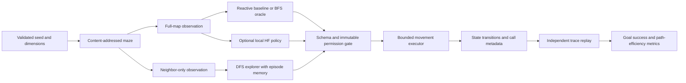
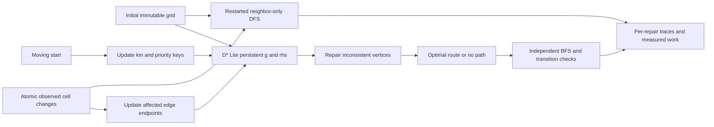

# Agent Arena: incremental replanning and replayable navigation

Generate solvable mazes, compare navigation policies, and independently replay every exported movement. The default implementation is classical search and exploration: no model, training, credentials, or network access is required. An optional local Hugging Face policy performs actual inference from an explicitly supplied checkpoint; its real model quality remains untested.

The implementation implements **actual D* Lite**: persistent `g/rhs` labels, an inconsistent-state priority queue, obstacle-cost repair, and moving-start key correction. Every repaired route is checked against an independent BFS, including disconnection and reopening. The measured comparison reports both fewer vertex expansions and higher edge-maintenance work, rather than calling operation counts a universal speedup.



## Run as a standalone repository

Python 3.11+; the default runtime and tests use only the standard library.

```bash
python -m pip install -e .
python -m agent_arena demo --output artifacts/demo.json
python -m agent_arena evaluate --output artifacts/evaluation.json
python -m agent_arena replay --input artifacts/evaluation.json --output artifacts/replay.json
python -m agent_arena replan-evaluate --output artifacts/replanning.json
python -m unittest discover -s scenarios -v
```

The installed `agent-arena` command supports the same arguments. `make test`, `make demo`, `make evaluate`, and `make replay` are available after installation. Omit `--output` to print JSON. Evaluation exits 1 on an invariant failure; invalid input, replay rejection, file errors, and an unrun optional model evaluation exit 2 with a structured error/report.

```bash
python -m agent_arena demo --seed 101 --width 13 --height 9 --max-steps 128
```

## Dynamic replanning with real incremental search

```bash
python -m agent_arena replan-evaluate --seed 300 --output artifacts/replanning-seed-300.json
```

The full command uses 12 independently seeded 15×15 worlds and 12 observed events per world: route closure/reopening, goal isolation/restoration, goal blocking/reopening, idempotent observations, shortcuts, mixed cell changes, and three explicit start moves. Each planner sees the same world/start/goal at every snapshot. D* Lite receives the initial map plus a complete change feed; repeated BFS receives each fresh map; the existing DFS receives neighbor-only observations and resets per snapshot. DFS is therefore an exploration comparison with a different information budget.



Measured over **156/156 repaired snapshots**, D* Lite matched independent BFS on every optimal cost/no-path decision; **126/126 reachable routes were shortest**, and all **30 no-path cases** were retained. Total vertex expansions were **5,108 D* Lite versus 13,193 repeated BFS**. However, edge inspections were **102,522 versus 52,268** because D* maintains lookahead labels and extracts paths. These counts are not a measured wall-clock speedup. The restarted DFS found every reachable goal but took longer routes: mean 59.35 movements versus the optimal mean 25.24.

All 12 idempotent observations and all 36 start moves repaired with **zero additional label-changing vertex expansions**. Reports separate initial search work from later repairs and preserve every case, change observation, path, queue/label branch, and operation count. See [transcripts/replanning-summary.json](../transcripts/replanning-summary.json), the [complete seed-300 trace](../transcripts/replanning-seed-300.json), [arena-notes/search-and-memory.md](search-and-memory.md), and [arena-notes/repair-work-measurements.md](repair-work-measurements.md).

```python
from agent_arena import CellChange, DStarLite, GridSnapshot

planner = DStarLite(GridSnapshot(7, 7, frozenset(), (5, 5)), (1, 1))
assert planner.repair()["path_length"] == 8
planner.apply_changes([CellChange((5, 5), True)])
assert planner.repair()["status"] == "no_path"
planner.apply_changes([CellChange((5, 5), False)])
planner.move_start((2, 1))
assert planner.repair()["path_length"] == 7
```

Cell changes alter incident unit-cost edges; arbitrary weighted edges or changing goals are not implemented. Each repair is bounded and a budget failure returns an error, never a BFS fallback. The new experiment has its own report schema and independent BFS/route validation; the legacy `replay` command accepts the original episode schema, not replanning reports.

## Policies and observation contracts

| Policy | Information available | Behavior |
| --- | --- | --- |
| `reactive_manhattan` | Full map, position, goal, budget, action allowlist | Memoryless greedy neighbor selection; may cycle. |
| `bfs_planning_oracle` | Same full-map information | Exact shortest-path reference; no learned reasoning. |
| `local_dfs_explorer` | Immediate four-neighbor occupancy, position, goal, budget, allowlist; **no Maze reference** | Remembers visited cells and backtracks; state resets each episode. |
| Optional `local_hf_causal_lm` | Full-map observation rendered as JSON | Real local causal-LM inference with strict single-action parsing. |

The neighbor-only explorer demonstrates memory under partial observation. Its information budget differs from the full-map policies and is labeled separately in each episode and metric. It is not an equal-information model-quality comparison. The DFS implementation also handles cyclic walkable maps; the procedural evaluation uses perfect mazes.

The application owns the environment and the allowlist. A policy proposes `north`, `east`, `south`, or `west`; only the executor applies a single-cell move. Public maze/observation constructors validate dimensions, coordinates, types, and walkability and defensively freeze mutable inputs. Policy text cannot authorize a new action.

## Budgets, failure, and traces

- Generated dimensions are odd integers in `[5, 31]`; seeds are signed 32-bit integers. The maximum map has 961 cells.
- Default episodes permit 128 tool attempts, three uses of an identical state/action pair, three consecutive blocked moves, and two seconds. Steps cap at 4,096; episode deadlines cap at 60 seconds. Numeric booleans, NaN, and malformed allowlists are rejected.
- `steps` counts executed movement-tool calls, including blocked moves. `policy_attempts` also includes a rejected or failed selection. Rejected actions never change position. Policy reset failures are separate from action attempts.
- Stop reasons include goal reached, step/deadline/cancellation budgets, invalid or denied actions, repetition, no progress, and policy errors. A goal reached by an accepted move is recorded immediately; a later bookkeeping clock read cannot erase it.
- Every episode includes its actual maze fingerprint, initial/final state, permissions, limits, observation regime, optimal path length, and bounded transition trace. Errors omit raw exception messages and invalid model text. Model call metadata survives generation errors, malformed output, post-selection deadlines, and cancellation.

Synchronous Python policies are trusted local code. Frozen objects and the movement gate are application contracts, not a sandbox against malicious Python. Deadlines are checked around calls; they cannot interrupt a hung process or native kernel. Run untrusted policies under a process supervisor.

## Evaluation and actual measured results

`rulesets/splits.json` matches the generated manifest. Development seeds `0–7` use 9×9 maps; release seeds `100–111` use 11×11, 13×9, and 9×13 maps. A separate exploration stress split uses seeds `200–205` and larger 15×15, 17×13, and 13×17 maps. Every maze's actual geometry is hashed; default and optional-model reports share the same manifest fingerprint.

Measured synthetic release results with a 128-step budget:

| Policy | Exact goal success | Mean steps among successes | Success-weighted path efficiency |
| --- | ---: | ---: | ---: |
| Full-map reactive baseline | 3/12 (25%) | 16.00 over 3 successes | 0.2500 |
| Full-map BFS oracle | 12/12 (100%) | 22.67 over 12 successes | 1.0000 |
| Neighbor-only DFS explorer | 12/12 (100%) | 39.67 over 12 successes | 0.6400 |

On the six larger stress mazes with a 512-step budget, BFS and neighbor-only DFS each reached **6/6** goals. Their mean successful path lengths were 49.33 and 77.33; success-weighted efficiencies were 1.0000 and 0.7335 respectively. Mean steps with different successful-case denominators are not a speed ranking.

Success-weighted path efficiency averages `success × optimal_steps / max(actual_steps, optimal_steps)` over **all** episodes, counting failures as zero. The report also retains success-only efficiency and its denominator.

The original navigation evaluation contains 36 release episodes, 12 stress episodes, and eight adversarial/boundary checks. **56/56 invariant checks and 56/56 independent transition replays passed; all 51 unit tests passed.** The additional incremental-search tests include 1,000 generated differential repairs. The model-boundary tests use explicit doubles, not real weights. See [transcripts/evaluation-summary.json](../transcripts/evaluation-summary.json) for measured navigation evidence and the separate replanning report above.

Manifest SHA-256: `3d43b2c737bf291e2fbdd98ebcd1c5d867699fa2ed7d6de9ff835a9536333633`.

These are small synthetic contract benchmarks, not evidence of natural-language reasoning or production agent reliability. The published release cases are no longer hidden; introduce a fresh holdout when tuning a policy.

## Independent trace replay

`replay_episode(maze, episode)` validates fingerprint, start/goal, legal transitions, permissions, movement/state hashes, counters, repetition/no-progress limits, shortest-path length, and the final success claim without trusting the episode's success flag. The CLI reconstructs generated worlds and accepts a single episode or a bounded demo/evaluation container. Replay input caps at 20 MB and 200 episodes.

Replay rejects modified coordinates, actions, permissions, hashes, path metrics, and forged goal claims. It verifies consistency with the **recorded** limits; it is not a cryptographic signature, proof of model execution, wall-clock verification, or proof that the original policy selected those actions. The API accepts custom validated mazes; the CLI reconstructs procedural mazes only.

## Optional real local model policy

Provide an existing local causal-LM checkpoint containing `config.json`, tokenizer assets, and safetensors weights. No weights are bundled, fetched, or run during default verification.

```bash
python -m pip install -e '.[hf]'
python -m agent_arena hf-evaluate \
  --checkpoint /absolute/path/to/existing-local-checkpoint \
  --max-steps 32 --output artifacts/hf-evaluation.json
```

The adapter validates checkpoint metadata before optional imports, forces `local_files_only=True`, `trust_remote_code=False`, and `use_safetensors=True`, and records a framed SHA-256 fingerprint of local model/config/tokenizer bytes. It uses greedy, single-sequence generation with an explicitly pinned tensor return shape. Only one exact lowercase action is accepted; malformed output never becomes a BFS move.

The command compares the model with both full-map baselines on the same 12 release worlds, observations, and episode limits. Defaults cap input at 1,024 tokens, generation at eight new tokens, the **shared budget across all episodes** at 512 model calls, each generation at five cooperative seconds, and each episode at 60 seconds. Context is never silently truncated. Call counters and limits are not reset between episodes; prompt history is not carried across episodes.

Native loading/encoding/generation errors have stable codes and redacted messages. Failed inference records known input usage and marks output as unobserved when no result was returned; token counts are observed counts, not estimates of hidden partial computation. Provider calls are zero and local hardware cost is `null`. A missing checkpoint or unavailable optional dependency writes a `not_run` report with zero generation calls and exits 2. See [transcripts/hf-status.json](../transcripts/hf-status.json).

Real checkpoint loading and inference remain untested. The tests cover safe loader arguments, context overflow and nullable model limits, encoding/generation/loader failures, malformed output, call-budget exhaustion, timeout accounting, and trace preservation using clearly labeled doubles. Loading and full-byte fingerprinting happen outside episode deadlines and may require substantial memory/time; cooperative `max_time` cannot stop a blocked kernel.

Read [arena-notes/map-and-agent-boundaries.md](map-and-agent-boundaries.md) for the contracts and [arena-notes/trace-audit.md](trace-audit.md) for reproduced review findings, fixes, and verification evidence.
