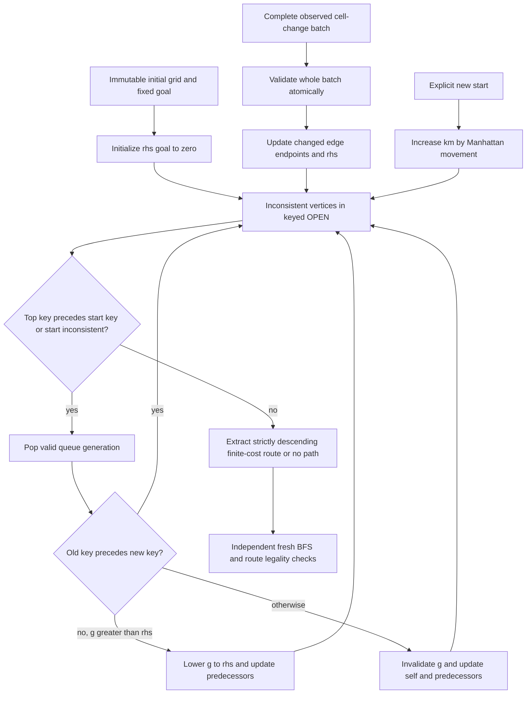

# Incremental replanning design

## Problem and chosen algorithm

The agent has a known four-neighbor map and a fixed goal. Traversability changes over time, and the current start moves. Fresh BFS solves every updated snapshot correctly but discards its previous search. `DStarLite` implements actual backward incremental search: persistent `g` and one-step lookahead `rhs` labels, an inconsistent-vertex priority queue, and a moving-start key correction. No BFS result, cached fixture answer, model output, or hand-coded route is substituted for repair.

D* Lite is appropriate here rather than a forward LPA* implementation that resets whenever the start changes. Both use local consistency; this implementation anchors the search at the goal so start movement can preserve useful labels.



## Graph and observation contract

`GridSnapshot` is an immutable 5–31 odd-width/height grid. Adjacent free cells have unit edge cost; an edge incident to a blocked cell has infinite cost. A `CellChange(cell, blocked)` may therefore change up to four undirected edges. Arbitrary weighted edges, diagonal movement, moving targets, and probabilistic maps are not implemented.

The planner starts from a full map, then receives a **complete application-provided change feed**. It does not discover hidden changes or infer them from an LLM. `apply_changes` validates the entire batch before replacing the graph, rejects duplicate cells and out-of-bounds changes, and cannot block the currently occupied start. A blocked goal is permitted and produces no path. Both the changed cell and all its potential neighbors have their lookahead recomputed, including previously blocked cells that reopen.

`move_start` updates the known start and `km`; it does not rebuild the label tables. The API permits explicit relocalization to any walkable cell, while the benchmark uses legal one-cell moves. The fixed goal is preserved across updates. Each observed change/move is recorded with its coordinates and graph version; nothing in an observation grants tool permissions or causes external side effects.

## Local consistency and keys

For goal `t`, `rhs(t) = 0`. For every other vertex:

```text
rhs(u) = min over adjacent v of [cost(u,v) + g(v)]
key(u) = (min(g(u), rhs(u)) + h(start,u) + km, min(g(u), rhs(u)))
```

Uninitialized labels are infinity. Manhattan distance is admissible and consistent for this unit-cost four-neighbor graph. A vertex is locally consistent exactly when `g == rhs`. Only inconsistent vertices belong to active OPEN.

The repair loop continues while OPEN's smallest key is less than the current start key or the start is inconsistent. A popped vertex follows one of three real algorithm branches:

1. **Rekey:** its stored key became stale after start movement; reinsert under the current key.
2. **Lower:** `g > rhs`; set `g = rhs` and update its potential predecessors.
3. **Invalidate:** otherwise set `g = infinity`, then update the vertex and its potential predecessors so cost increases propagate.

Start motion increments `km` by Manhattan distance between the old and new starts. Triangle consistency keeps stored keys usable as lower bounds, allowing lazy key repair rather than a full queue rebuild. Labels survive obstacle changes, no-path states, goal reopening, and moving-start queries.

## Queue and resource bounds

OPEN uses a binary heap plus a map from vertex to its current generation-tagged entry. Updating/removing a vertex invalidates the older heap entry. Pop/top prune stale entries; periodic heap compaction prevents unbounded lazy-deletion growth. Active entries and `g`/`rhs` labels are bounded by the grid's at most 961 vertices. Compaction keeps heap storage O(V).

Each observation contains at most 128 changes; at most 128 observations may be pending before a repair. One planner permits 256 repair attempts, including attempts that exhaust their budget. Default repair permits 100,000 valid queue pops, with an API cap of 1,000,000. The trace records at most 256 events, reports omitted events, and retains full aggregate counters. A budget exception returns no fabricated route; a later repair can resume its partial state.

Queue operations cost O(log V) amortized. Updating a vertex scans its bounded degree, then may change its queue entry. For P processed queue entries and U lookahead updates, work is O((P + U) log V + scanned edges), plus O(path length × degree) extraction. A local change may invalidate much of the graph: there is no guarantee of less work than a fresh search. BFS is O(V + E) on this unit-cost graph and can immediately reject a blocked goal; D* Lite may spend extra work maintaining reusable labels in that case.

## Path extraction and honest no-path behavior

Repair stops only when the start is consistent and no smaller queue key can improve it. A finite start label permits greedy successor selection by `cost + g`; every extracted step must reduce `g` strictly and stay on a unit-cost edge. Extraction is bounded by the number of cells and rejects inconsistent or cyclic labels. Infinite start distance or a blocked goal yields `path=None`, never a placeholder route. Start equals goal has length zero.

The independent checker compares status and path length against a new BFS, then checks every returned coordinate and transition in the simulator's separately updated immutable snapshot. Matching one tied route is not required; matching optimal cost is.

## Baselines and observation differences

- **Repeated BFS:** independent deque traversal with its own explicit adjacency code. It never reads D* labels, queue state, heuristic, or path extractor.
- **Restarted local DFS:** reuses the existing `LocalDFSExplorer` and neighbor-only observations. It resets exploration memory for each updated snapshot and records actual exploration/backtracking length, including work before discovering no path.
- **D* Lite:** keeps initial full-map knowledge plus the complete change feed and retains incremental search state.

All three are evaluated at the same start/goal on exactly the same changed world. DFS has less information and is an exploration baseline, not an equal-information optimal planner. These are snapshot replanning experiments; the simulator's explicit start moves are the physical trajectory, whereas DFS's per-snapshot exploration is evaluation work and does not move other algorithms' starts.

## Instrumentation and comparison limits

Repair traces record popped cell, old/new keys, prior `g/rhs`, branch, and resulting `g/rhs`. Counters retain queue pops/pushes, label-changing vertex expansions, lookahead updates, edge inspections, and compactions. Delta work includes change-processing work since the previous successful repair report; after a budget failure, resumed reporting includes that earlier work. Path extraction edge inspections are included.

BFS expansions are dequeued states; DFS expansions are neighbor-observation/selection calls; D* expansions are label-changing processed vertices, excluding rekeys. These are algorithm-specific operation counts, not identical CPU instructions. Edge inspection accounting exposes additional lookahead maintenance that vertex counts alone hide. The benchmark reports both, and makes no wall-clock or universal speedup claim. BFS lacks a heuristic, so initial-search differences are not pure evidence of incrementality; unchanged/moving-start zero-expansion repairs directly demonstrate state reuse.
